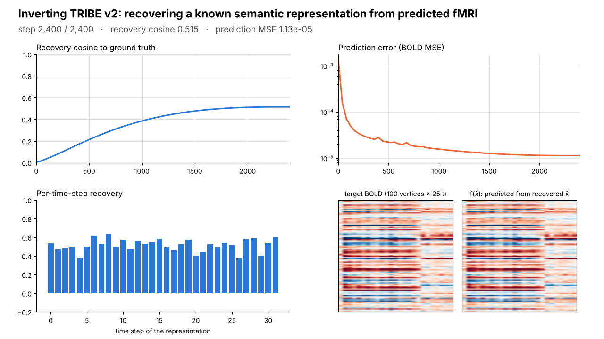

# Predictable Is Not Recoverable

**Conditioning and non-convexity of semantic decoding by inverting a deep brain encoding model (TRIBE v2)**

Abhranil Sarkar\*, Tanisha Choudhuri\*, Sharmila Nageswaran
School of Electronics Engineering (SENSE), Vellore Institute of Technology, Vellore, India
\*Joint first authors · Final-year Project-I (BECE497J), 2026–27

<p align="center"></p>

> **One-line result.** A near-perfect deep brain encoder does not by itself make meaning recoverable from fMRI. Inverting Meta's TRIBE v2 is a non-convex, direction-dependently conditioned problem: it *identifies* which stimulus was presented, on synthetic and real fMRI alike, but *reconstructs* only the components the model transmits well.

| | |
|---|---|
| **Interactive live demo** | [`demo/TRIBE_live_demo_offline.html`](demo/TRIBE_live_demo_offline.html): ten-scene presenter page with a 3-D cortex, an inversion lab that runs in the browser, and a replay of a real multi-start TRIBE v2 run (download and open in Chrome; works offline) · run-sheet: [`demo/DEMO_SCRIPT.md`](demo/DEMO_SCRIPT.md) |
| **Live demo on the real model** | [`notebooks/Live_Demo.ipynb`](notebooks/Live_Demo.ipynb) · [Open in Colab](https://colab.research.google.com/github/Ivxn404/semantic-decoding-tribe-inversion/blob/main/notebooks/Live_Demo.ipynb): ≈10 min on a free T4 |
| **Verification tests (Colab)** | [`notebooks/Verification_Tests.ipynb`](notebooks/Verification_Tests.ipynb) · [Open in Colab](https://colab.research.google.com/github/Ivxn404/semantic-decoding-tribe-inversion/blob/main/notebooks/Verification_Tests.ipynb): re-checks the initialisation study with a corrected (fit-matched) barrier test and the sensitivity probe |
| **Demo video** | [`demo/demo_inversion.mp4`](demo/demo_inversion.mp4): one real inversion through frozen TRIBE v2, every frame from logged values |
| **Run it in Colab (demo + synthetic)** | [`notebooks/Demo_and_Synthetic.ipynb`](notebooks/Demo_and_Synthetic.ipynb) · [Open in Colab](https://colab.research.google.com/github/Ivxn404/semantic-decoding-tribe-inversion/blob/main/notebooks/Demo_and_Synthetic.ipynb) |
| **Run it in Colab (real fMRI)** | [`notebooks/RealData_TextAudio.ipynb`](notebooks/RealData_TextAudio.ipynb) · [Open in Colab](https://colab.research.google.com/github/Ivxn404/semantic-decoding-tribe-inversion/blob/main/notebooks/RealData_TextAudio.ipynb) |
| **Full methods and results** | [`docs/Methods_and_Results.md`](docs/Methods_and_Results.md) |
| **Poster (A3, final review)** | [`poster/Poster_Sarkar_Choudhuri_Project1.pdf`](poster/Poster_Sarkar_Choudhuri_Project1.pdf) · [preview](poster/poster_preview.png) |
| **Final report** | [`report/Report_Sarkar_Choudhuri_Project1.pdf`](report/Report_Sarkar_Choudhuri_Project1.pdf) · [`.docx`](report/Report_Sarkar_Choudhuri_Project1.docx) |
| **Final presentation** | [`deck/Final_Sarkar_Choudhuri.pptx`](deck/Final_Sarkar_Choudhuri.pptx): the complete project in 73 slides |
| **Review decks** | [`deck/Review2_Sarkar_Choudhuri.pptx`](deck/Review2_Sarkar_Choudhuri.pptx) · [`deck/Review3_Sarkar_Choudhuri.pptx`](deck/Review3_Sarkar_Choudhuri.pptx) |

---

## Contents

1. [What this project does](#1-what-this-project-does)
2. [Why it is new](#2-why-it-is-new)
3. [Key results](#3-key-results)
4. [Repository map](#4-repository-map)
5. [Quick start](#5-quick-start)
6. [Reproducing every result](#6-reproducing-every-result)
7. [The real-fMRI pipeline in detail](#7-the-real-fmri-pipeline-in-detail)
8. [Data, models and licences](#8-data-models-and-licences)
9. [Limitations](#9-limitations)
10. [How to cite](#10-how-to-cite)

---

## 1. What this project does

A **brain encoding model** predicts the fMRI response a stimulus evokes. **Decoding** runs the other way: from brain activity back to the stimulus. Encoders have become very accurate, and decoding is often assumed to follow. We test that assumption directly.

[TRIBE v2](https://github.com/facebookresearch/tribev2) (Meta FAIR, 2026) is an open-weight, 177 M-parameter trimodal transformer that predicts responses at 20 484 cortical vertices (fsaverage5) from video, audio and language features. Its public pipeline is not differentiable end to end (speech synthesis, transcription and frozen feature extractors sit in front of it), so we **re-enter the network after feature aggregation**, where it is pure tensor arithmetic, and treat the aggregated representation `x ∈ ℝ^(T×1152)` as the free variable:

```
stimulus ──► extractors (not differentiable) ──► x  ──► TRIBE v2 (frozen) ──► f(x): 20 484 vertices × 100 s
                                                 ▲                                   │
                                                 └──── gradient to x only (Adam) ◄── loss vs target y
```

Inversion is `x̂ = argmin_x ‖f(x) − y‖²` (Adam, lr 5 × 10⁻², cosine schedule; on real fMRI, 1 − Pearson r). Re-entering at this boundary reproduces the released model's predictions exactly (r = 1.0000).

We then ask three questions, first with **exact synthetic ground truth** (`y = f(x)` for a known `x`), then on **real fMRI** (LeBel et al., 2023):

1. **Uniqueness** — do equally good fits give the same answer?
2. **Conditioning** — which directions of `x` does the operator transmit well or poorly, and how does that limit recovery?
3. **Regional recoverability** — which cortical networks carry recoverable information, and does that follow how predictable they are?

## 2. Why it is new

| Closest prior work | Nonlinear deep encoder | Optimises encoder input | Tests uniqueness / conditioning | Region-wise recoverability |
|---|:-:|:-:|:-:|:-:|
| Kay et al., *Nature* 2008 | ○ | ○ | ○ | ○ |
| Gardner & Liu, *eNeuro* 2019 | ○ | ● | ● | ○ |
| Tang et al., *Nat. Neurosci.* 2023 | ○ | ● | ○ | ● |
| d'Ascoli et al., TRIBE v2, 2026 | ● | ○ | ○ | ○ |
| Bladon & Bent, arXiv 2605.13904, 2026 | ● | ● | ○ | ○ |
| Benchetrit et al., arXiv 2606.06345, 2026 | ● | ○ | ○ | ○ |
| **This work** | **●** | **●** | **●** | **●** |

Gardner & Liu proved that *linear* inverted encoding models recover the stimulus only up to an invertible linear transform. We ask the same question of a 177 M-parameter nonlinear encoder, where no closed form exists. A literature search on 9 October 2026 (arXiv, Google Scholar, web) found no published inverse or identifiability analysis of a deep foundation brain encoder; the two TRIBE v2 follow-ups use it for feature visualisation and for synthetic training data.

## 3. Key results

**Synthetic (exact ground truth)**

| Finding | Evidence | Figure |
|---|---|---|
| Encoding accuracy does not certify decoding | Encoding error falls **28.4×** while recovery saturates at cosine 0.944; the final halving of error buys **+0.015** | `fig_dissociation.png` |
| Fit-matched solutions disagree, reproducibly | 7 of 8 initialisations reach matched fit; min pairwise cosine **0.817 ± 0.007** over 4 ground truths | `fig_nonconvex.png` |
| Separate minima, not a null space | On the straight path between two distinct, equally good blind fits the error rises a median **4.8×** in the middle (29 of 40 pairs, 4 ground truths); **8.1 ± 3.2×** towards a deeper minimum near the truth (forward passes only) | `fig_barrier_path.png` |
| Error lies in the weakest directions | Sensitivity along `d` is **2.15 ± 0.17× below** the median of 200 random directions (4 ground truths; 1.9× on the first) | `fig_sensitivity.png` |
| Gain is identifiable | A 10 % rescale gives 7.5× the residual floor | `fig_gain.png` |
| Robust to noise, sparse observation | Noise 0 → 100 % of BOLD SD: 0.836 → 0.298, retrieval ≈ 0.99; 2 000 random vertices (10 %) reach 0.777 | `fig_noise.png`, `fig_extent.png` |
| Generic priors hurt | ℓ₂: +0.032 at best; temporal smoothness: 0.527 → 0.0008 | `fig_priors.png` |
| Nonlinear ≫ linear | Gradient inversion 0.918 vs best ridge decoder 0.060 (≈ 15×) | `fig_baseline.png` |

**Regional (6 Destrieux networks vs size-matched random vertices)**

| Network | Sensitivity (× cortex) | Recovery: network vs random | Difference |
|---|:-:|:-:|:-:|
| Somatomotor | 0.73 (least responsive) | 0.851 vs 0.748 | **+0.102** |
| Language (L) | 1.21 | 0.752 vs 0.729 | +0.023 |
| Auditory | 1.29 | 0.386 vs 0.371 | +0.015 |
| Language (R) | 1.22 | 0.750 vs 0.739 | +0.011 |
| Default mode | 1.03 | 0.727 vs 0.723 | +0.004 |
| Visual | 1.60 (most responsive) | 0.629 vs 0.754 | **−0.125** |

The most predictable network is the hardest to decode from; response diversity (participation ratio 18.6 vs 10.3) explains the extremes. See `fig_roi_recovery.png`, `fig_roi_pred_vs_rec.png`, `brain_topography_grid.png`.

**Real fMRI** (LeBel et al. 2023, subject UTS03, held-out story *wheretheressmoke*; every tuning choice fitted on the other five stories)

| Measure | Text + audio | Audio only | Chance / ceiling |
|---|:-:|:-:|:-:|
| Encoding r, top 2 000 vertices | **0.478** (56 % of ceiling) | 0.273 | ceiling 0.859 |
| Forward identification, 20-s windows (top-1) | **58.6 %** | 20.7 % | 0.5 % (194 windows) |
| Inverting measured BOLD, 100-s segments (top-1) | **4 / 5** | 5 / 5 | 2.2 % (45 segments) |
| Cosine of x̂ to the true x | 0.024 | 0.062 | — |
| Oracle: inverting the model's own prediction | 5 / 5, cosine 0.224 | — | — |

On real data, as in simulation, the inverse identifies **which** moment was heard but does not reconstruct its representation; the oracle shows most of the loss is the operator's conditioning, not measurement noise. See `fig_realdata_audio_text.png`.

## 4. Repository map

```
├── README.md                      ← you are here
├── requirements.txt               Python dependencies (TRIBE v2 itself is installed from GitHub)
├── notebooks/
│   ├── Demo_and_Synthetic.ipynb   Colab: live demo + every synthetic and regional experiment
│   └── RealData_TextAudio.ipynb   Colab: real-fMRI validation with text + audio features
├── scripts/                       all analysis code (see scripts/README.md for one line per file)
├── results/                       every number in the manuscript, as JSON / logs
├── figures/                       every figure, regenerated by the make_*.py scripts
├── demo/                          demo video, poster frame, and the code that recorded it
├── data/                          what is redistributable (fsaverage5 sampling matrix); see data/README.md
├── docs/Methods_and_Results.md    full methods and results write-up
├── deck/                          Review II and Review III decks (.pptx) and their source
├── poster/                        A3 final-review poster (.pptx, .pdf) and its build script
└── report/                        final Project-I report (.pdf, .docx) and its build scripts
```

## 5. Quick start

**Easiest: Google Colab (free T4 GPU, nothing to install locally).** Open [`notebooks/Demo_and_Synthetic.ipynb`](https://colab.research.google.com/github/Ivxn404/semantic-decoding-tribe-inversion/blob/main/notebooks/Demo_and_Synthetic.ipynb), set *Runtime → Change runtime type → T4 GPU*, and run the cells top to bottom. Part A inverts TRIBE v2 live in about five minutes.

**Local (Linux, Python 3.10–3.13; a GPU is strongly recommended):**

```bash
git clone https://github.com/Ivxn404/semantic-decoding-tribe-inversion.git
cd semantic-decoding-tribe-inversion
pip install "tribev2[plotting] @ git+https://github.com/facebookresearch/tribev2.git"
pip install -r requirements.txt
python -c "from huggingface_hub import hf_hub_download as d; [d('facebook/tribev2', f, local_dir='weights') for f in ['config.yaml','best.ckpt']]"
cd scripts
python synthetic_characterisation.py gain --quick     # smoke test, a few minutes on CPU
python demo_run.py && python make_demo_video.py       # re-record the demo video (needs ffmpeg)
```

All paths are relative to the repository root. Override with environment variables if needed: `PROJECT_ROOT`, `TRIBE_WEIGHTS` (default `weights/`), `LEBEL_WORK` (default `data/lebel/`), `ATLAS_DIR` (default `data/atlas/`), `RESULTS_DIR`.

**Known install pitfalls** (all handled in the notebooks): pin `transformers<4.57` (newer versions break the extractor import); pin `torchaudio==2.6.0` to match TRIBE v2's torch; on Colab pin `numpy<2.1` and restart the session after installing. On CPU-only machines `lebel_features.py` moves both extractors to CPU automatically.

## 6. Reproducing every result

| Manuscript item | Command (from `scripts/`) | Output |
|---|---|---|
| IV-A encoding vs decoding | `python synthetic_characterisation.py dissociation` | `results/synth_dissociation.json` |
| IV-B fit-matched solutions | `python synthetic_characterisation.py inits` | `results/synth_inits.json` |
| IV-C barrier test | `python synthetic_characterisation.py barrier` | `results/synth_barrier.json` |
| IV-D directional sensitivity | `python synthetic_characterisation.py sensitivity` | `results/synth_sensitivity.json` |
| IV-E Table IV | `python synthetic_characterisation.py gain noise extent priors ridge bandwidth manifold` | `results/synth_*.json` |
| IV-F modality topography | `python roi_sensitivity.py && python roi_share_stats.py` | `results/roi_sensitivity.json`, `roi_share_stats.json` |
| IV-F regional recovery | `python roi_inversion.py` (checkpoints every 500 steps; re-run to resume) | `results/roi_inversion.json` |
| IV-F participation ratio | `python roi_dimensionality.py` | `results/roi_dimensionality.json` |
| IV-G real fMRI | the real-data notebook, or §7 below | `results/realdata_audio_text.json` |
| Figures | `make_figures.py`, `make_roi_figs.py`, `make_brain_figs.py`, `make_topo_grid.py`, `make_realdata_fig.py audio_text` | `figures/` |
| Demo video | `demo_run.py` then `make_demo_video.py` | `demo/` |

**Provenance note.** The original synthetic experiments (Sections IV-A to IV-E) were run stage by stage in Google Colab notebooks on a T4 GPU; their logged numbers are in [`docs/Methods_and_Results.md`](docs/Methods_and_Results.md) and are plotted by `make_figures.py`. `synthetic_characterisation.py` consolidates those stages into one script with the same protocol (same ground-truth generator and seeds: the gain experiment reproduces the logged values exactly, e.g. MSE 4.695 × 10⁻⁴ at α = 0.5). Initialisation names and random draws for the controls may differ slightly from the Colab runs, so expect agreement in effect size, not to the last digit. The regional and real-data results were produced by the exact scripts in this repository.

## 7. The real-fMRI pipeline in detail

1. **Data.** OpenNeuro [ds003020](https://openneuro.org/datasets/ds003020) (LeBel et al., 2023), subject UTS03: the authors' preprocessed responses (95 556 cortical voxels, TR 2 s) for six stories (66.6 min, 10 363 words). *wheretheressmoke* is the mean of 10 repeats and is not in TRIBE v2's training set, so it is the held-out test story.
2. **Surface projection** (`lebel_register.py` → `lebel_sampler.py` → `lebel_apply.py`). TRIBE v2's own projector settings: a 3-mm ball of 20 points around each mid-cortical fsaverage5 vertex, trilinear weights inside the cortical mask. Vertices go MNI → subject T1 through an ANTs SyN warp, then into functional voxels through the pycortex `coord` transform. The result is a sparse 20 484 × 95 556 matrix, shipped as `data/lebel/pycx/sampler.npz`, so you do not need to redo registration. Validation: homotopic left–right correlation 0.635 vs −0.017 heterotopic (above 97 % of alternatives); a scrambled-vertex control falls to chance. `lebel_project.py` is an earlier 4-D-warp approach kept for reference (it runs out of memory on large stories).
3. **Features** (`lebel_features.py`). TRIBE v2's own pipeline, with the dataset's TextGrid word timings instead of WhisperX: w2v-BERT 2.0 audio and Llama-3.2-3B text (sentence and 1 024-word context), 100-s segments. On GPUs under 20 GB, Llama is loaded in half precision; run one story per process so only one large model is on the GPU at a time.
4. **Evaluation** (`lebel_eval.py`). Alignment offset and the 2 000 analysis vertices are chosen on the five training stories only. Then: encoding r per network with a split-half noise ceiling; forward identification of 20-s windows among 194; inversion of measured BOLD for each held-out 100-s segment and identification of x̂ among the true representations of all 45 segments; an oracle that inverts the model's own prediction. `--regional` adds a per-network inversion (not used in the manuscript; see Limitations).

`realdata_lebel.py` is the first version of this pipeline, kept for reference.

## 8. Data, models and licences

* **Code in this repository:** MIT licence ([`LICENSE`](LICENSE)).
* **TRIBE v2 weights:** not included. Downloaded from Hugging Face (`facebook/tribev2`) under Meta's licence (CC BY-NC 4.0: non-commercial research use).
* **Llama-3.2-3B:** gated on Hugging Face; request access and log in with your own token. Only needed for real-data text features.
* **fMRI data:** not included (several GB). Downloaded automatically from OpenNeuro ds003020 by `lebel_apply.py`. Only the derived sampling matrix is shipped.
* **Atlas:** Destrieux surface atlas, fetched automatically by nilearn.

## 9. Limitations

* Synthetic ground truth lies in a random 8-D subspace, not in real language embeddings; qualitative findings transfer to real data, absolute values may not.
* Inversion targets the aggregated representation, one stage after the raw extractor features.
* All solutions use Adam; the non-convexity claim rests on optimiser-independent forward-pass tests and on replication across four ground truths.
* The public release ships only the average-subject layer and no explicit haemodynamic operator.
* Real data: one subject, one held-out story, five inversion queries. A per-network test on real data needs held-out stories from more subjects, because the other five stories were in TRIBE v2's training set.

## 10. How to cite

```bibtex
@misc{sarkar2026predictable,
  title  = {Predictable Is Not Recoverable: Conditioning and Non-Convexity of Inverting a Foundation Brain Encoding Model},
  author = {Sarkar, Abhranil and Choudhuri, Tanisha and Nageswaran, Sharmila},
  year   = {2026},
  note   = {School of Electronics Engineering, Vellore Institute of Technology},
  url    = {https://github.com/Ivxn404/semantic-decoding-tribe-inversion}
}
```

**Acknowledgements.** Guided by Dr. Sharmila Nageswaran, SENSE, VIT Vellore. We thank Meta FAIR for releasing TRIBE v2 and LeBel et al. for releasing their dataset.
