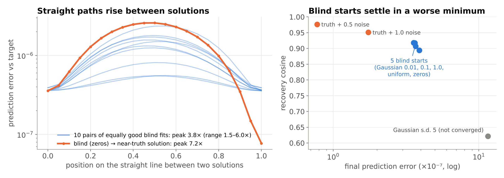

# Conditioning and Non-Convexity of Semantic Decoding by Inversion of a Deep Brain Encoding Model

**Computational section — Methods and Results**

Prepared by A. Sarkar (23BML0077) and T. Choudhuri (23BML0081). Version 2: adds the regional analysis (§2.12–2.15) and the real-data protocol (§4).

This document contains the material intended for the paper. Exploratory runs, superseded measurements and environment notes are omitted; where a result was retracted or is unusable, that is stated explicitly rather than dropped.

---

## 1. Methods

### 1.1 Problem formulation

A brain encoding model defines a forward operator

> **f : X → Y**,  X = ℝ^(T×H),  Y = ℝ^(V×T′)

mapping a semantic representation **x** to a predicted cortical response **y**. Decoding is the inverse problem: given an observed response **y**, recover **x**.

The two problems are not equivalent. Accuracy of *f* constrains neither the conditioning nor the uniqueness of *f*⁻¹. An operator may be highly predictive in the forward direction while the corresponding inverse is ill-conditioned, non-convex, or non-unique. This work measures those properties directly.

### 1.2 Forward operator

TRIBE v2 [10] was used as the forward operator, with all weights frozen. Relevant architecture:

| Component | Type | Parameters |
|---|---|---|
| `encoder` | Transformer encoder | 127.47 M |
| `predictor` | SubjectLayersModel | 41.97 M |
| `projectors` | ModuleDict | 4.23 M |
| `low_rank_head` | Linear (1152 → 2048) | 2.36 M |
| `pooler` | AdaptiveAvgPool1d | — |
| **Total** | | **177.21 M** |

Hidden width H = 1152. Output shape (V, T′) = (20 484, 100), corresponding to the fsaverage5 cortical surface. Configuration: `modality_dropout` 0.3, `temporal_dropout` 0.0, `linear_baseline` False, `temporal_smoothing` None, `subject_embedding` False.

### 1.3 The inversion boundary

The public inference path is **not differentiable end to end**. Text stimuli are converted to speech, transcribed for word-level alignment, and passed through a frozen language model before reaching the network; speech synthesis and transcription break the gradient. The published `predict()` method additionally executes under `torch.inference_mode()`, which permanently excludes its tensors from autograd.

Inspection of `FmriEncoderModel.forward` shows that `aggregate_features(batch)` is the sole point at which batch structure is consumed:

```
x = self.aggregate_features(batch)          # B, T, H  — not differentiable
x = self.transformer_forward(x, subject_id)
x = self.low_rank_head(...)
x = self.predictor(x, subject_id)
out = self.pooler(x)                        # B, V, T′
```

Everything downstream of the first line is tensor arithmetic and is differentiable with respect to **x**. The aggregated feature tensor **x** ∈ ℝ^(1×32×1152) is therefore adopted as the free variable, and the operator is re-entered at that boundary. Gradient flow was verified (‖∂y/∂x‖ = 7.97 × 10³, all entries non-zero).

**Consequence for interpretation.** Inversion targets the aggregated representation, one stage downstream of raw language-model embeddings. Results characterise the operator from that point onward.

### 1.4 Inversion procedure

**x** is recovered by minimising prediction error through the frozen operator:

> **x̂** = argmin_x ‖ f(x) − y ‖² + λR(x)

Adam, learning rate 5 × 10⁻², cosine-annealed over the full step budget. Weights frozen throughout; only **x** is optimised. Where regularisation is applied, R is either an ℓ₂ penalty on **x** or a first-difference temporal smoothness penalty.

### 1.5 Synthetic evaluation

Real fMRI does not admit exact evaluation, because the true semantic representation underlying a measured response is unknown. All results below instead use synthetic ground truth: a known **x** is generated, propagated through *f* to obtain **y**, and recovery of **x** from **y** alone is then measured exactly.

Two stimulus families were used:

- **smooth** — a trajectory in an 8-dimensional random subspace, with rate of semantic change controlled by a `cycles` parameter (default 2.0)
- **white** — i.i.d. Gaussian, deliberately off-manifold

Unless stated otherwise T = 32, stimulus family `smooth`, `cycles` = 2.0, all 20 484 vertices observed, no added noise.

### 1.6 Metrics

| Metric | Definition |
|---|---|
| **Recovery cosine** | Mean per-timestep cosine similarity between **x̂** and **x**. Primary metric. |
| **Relative error** | ‖**x̂** − **x**‖ / ‖**x**‖. Sensitive to magnitude as well as direction. |
| **Encoding error** | ‖f(**x̂**) − f(**x**)‖ / ‖f(**x**)‖. Forward-direction fit. |
| **Retrieval** | Percentile rank of the true representation against distractors drawn from other timepoints of the same trajectory. |
| **Directional sensitivity** | s(v) = ‖f(**x** + εv) − f(**x**)‖ / ε for unit v; a finite-difference probe of the Jacobian along v. |

Recovery cosine and relative error behave differently under noise and should be reported together; either alone is misleading.

---

## 2. Results

### 2.1 Encoding accuracy does not predict decoding accuracy

Independent inversions were run at increasing step budgets and encoding error plotted against recovery.

| Steps | Encoding rel. error | Recovery cosine |
|---:|---:|---:|
| 250 | 7.546 × 10⁻² | 0.0505 |
| 500 | 6.043 × 10⁻² | 0.1081 |
| 1 000 | 5.098 × 10⁻² | 0.2374 |
| 2 000 | 4.073 × 10⁻² | 0.4529 |
| 4 000 | 2.733 × 10⁻² | 0.6708 |
| 8 000 | 1.380 × 10⁻² | 0.8362 |
| 16 000 | 5.649 × 10⁻³ | 0.9282 |
| 32 000 | 2.658 × 10⁻³ | 0.9436 |

Encoding error falls **28.4-fold** across this range while recovery saturates: the final halving of encoding error (5.65 × 10⁻³ → 2.66 × 10⁻³) buys only 0.0154 in recovery cosine.

**This is the central result.** Forward-model accuracy and decodability are dissociable quantities, and improvements in the former yield sharply diminishing returns in the latter.

*Figure 1: encoding error vs. recovery cosine, log–log.*

A separate convergence run reached cosine 0.9101 at 64 000 steps. That run snapshotted a single annealed trajectory at intermediate points, so its early values are not directly comparable to the independent runs above; the table is the valid measurement and the convergence run is reported only as corroboration that recovery plateaus.

### 2.2 The inverse problem is non-convex

Inversions were initialised from distributions differing in scale and structure, then compared. Only solutions reaching comparable prediction error (within 2× of the best fit) were admitted, so that under-converged runs cannot masquerade as alternative solutions.

At 16 000 steps, 7 of 8 initialisations reached matched fit (2.518–2.959 × 10⁻⁷); `gauss_5.0` was excluded at 3.4× the best fit. Among the matched set:

- mean pairwise cosine between solutions **0.9268**
- minimum pairwise cosine **0.8352** (`uniform` vs `truth_perturbed`)
- mean cosine to ground truth **0.9142**

Replication across four independent ground-truth trajectories at 14 000 steps:

| Ground truth | Best fit | Mean pairwise | Min pairwise |
|---|---:|---:|---:|
| 0 | 3.514 × 10⁻⁷ | 0.8928 | 0.8068 |
| 1 | 3.645 × 10⁻⁷ | 0.8934 | 0.8151 |
| 2 | 3.105 × 10⁻⁷ | 0.9007 | 0.8257 |
| 3 | 3.125 × 10⁻⁷ | 0.8996 | 0.8186 |
| **Aggregate** | | **0.8966 ± 0.0036** | **0.8165 ± 0.0068** |

The effect is highly reproducible (spread 0.019 across all four), the worst-disagreeing pair is the same in every case, and recovered norm ratios cluster by initialisation to within ~0.01 across trajectories. Distinct solutions are therefore reached systematically, not stochastically.

*Figure 2: pairwise agreement among fit-matched solutions, four ground truths.*

*Table: per-initialisation fit, recovery and norm ratio.*

### 2.3 The divergence reflects non-convexity, not non-identifiability

Two explanations remain for §2.2: solutions occupy a connected flat region of the loss surface (a null space, implying information loss), or they are distinct local minima separated by barriers (non-convexity, implying an optimisation limit). These were distinguished directly.

**Corrected test (19 October 2026, `notebooks/Verification_Tests.ipynb`, results in `results/verification/`).** The prediction error against the target was measured at 21 points on the straight line between every pair of fit-matched solutions that were blind to the truth (five starts within 1.1× of each other, 3.57–3.90 × 10⁻⁷ after 14 000 steps; agreement mean 0.954, minimum 0.890). A null space would keep the error flat along the line; distinct minima make it rise.

| Measure | Value |
|---|---:|
| Peak / worse endpoint, 10 blind pairs | median 3.8× (range 1.5–6.0×) |
| Error of the two near-truth controls vs the best blind fit | 4.6× lower (7.7 × 10⁻⁸) |
| Recovery: near-truth controls vs blind starts | 0.951–0.976 vs 0.894–0.918 |
| Peak on the line from the best blind solution to the near-truth one | 7.2× the blind end |



**Withdrawn.** The earlier version of this test (perturbation along **d** against random directions; ratios 2.6× → 0.6×) chose its pair as the least similar of all eight starts, which paired an under-converged solution (Gaussian s.d. 5, error 1.15 × 10⁻⁶). With a fit-matched pair the change along **d** stays far below random directions at every scale (2.6×, 6.0×, 13×, 258×), as it must when both ends fit the target, so that comparison cannot detect a barrier. `scripts/synthetic_characterisation.py` now selects the pair among fit-matched blind solutions and also records the straight-path profile.

**The null-space hypothesis is therefore rejected.** Fit-matched blind solutions are separated by barriers from each other and from a deeper minimum near the truth: the inverse problem is non-convex, and incomplete recovery is an optimisation limit rather than an information-theoretic one.

Locality was confirmed independently: the sensitivity advantage of **d** falls from 2.0× at the trajectory where it was found to 1.0–1.1× at unrelated ground truths, so **d** is not a globally privileged direction.

### 2.4 Recovery error concentrates in low-sensitivity directions

Directional sensitivity was probed at a recovered solution against 200 random directions.

- sensitivity along **d**: 9.468 × 10⁻²
- median over random directions: 1.768 × 10⁻¹
- random minimum / maximum: 1.348 × 10⁻¹ / 2.505 × 10⁻¹
- **ratio 1.9×; percentile 0.0** — **d** falls below *every* random direction sampled
- sensitivity along the ground truth itself: 1.970 × 10⁻¹

All six pairwise difference directions lie below the random median, by 1.4× to 2.4×.

Recovery error is thus systematically oriented along the operator's least sensitive directions. This is anisotropic ill-conditioning, quantified: the operator responds roughly half as strongly to the components that inversion fails to recover.

*Figure 3: distribution of directional sensitivity over 200 random directions, with difference directions marked.*

### 2.5 Representation gain is identifiable

Whether the operator determines the magnitude of **x**, or only its direction, was tested by rescaling the ground truth and measuring the change in predicted response against the optimiser's own residual floor (1.3 × 10⁻⁶).

| α | MSE vs. f(**x**) | Relative to floor |
|---:|---:|---:|
| 0.50 | 4.695 × 10⁻⁴ | 361× |
| 0.90 | 1.201 × 10⁻⁵ | 9.2× |
| 1.00 | 0 | — |
| 1.10 | 9.714 × 10⁻⁶ | 7.5× |
| 2.00 | 7.644 × 10⁻⁴ | 588× |

Only α = 1 lies within the noise floor; a 10% rescaling already produces 7.5× the residual. **Gain is identifiable**, excluding the simplest alternative account of incomplete recovery.

A related hypothesis — that recovery error is dominated by a single global scale factor — was also tested and refuted. Rescaling the recovered trajectory to match the true norm changed relative error from 0.5516 to 0.5675, i.e. marginally worse, despite a norm correlation of 0.9152.

### 2.6 Conditioning with respect to measurement noise

Gaussian noise was added to the observed response at increasing fractions of its standard deviation.

| Noise | Recovery cosine | Relative error | Retrieval |
|---:|---:|---:|---:|
| 0.00 | 0.8362 | 0.5516 | 0.986 |
| 0.05 | 0.8293 | 0.5592 | 0.991 |
| 0.10 | 0.8096 | 0.5823 | 0.988 |
| 0.25 | 0.7036 | 0.7260 | 0.990 |
| 0.50 | 0.5163 | 1.1109 | 0.987 |
| 1.00 | 0.2975 | 2.0620 | 0.988 |

Degradation is monotone and graceful — no cliff — indicating the inverse is reasonably well conditioned with respect to additive noise. Note the dissociation: relative error rises 3.7-fold while retrieval remains near ceiling throughout. Direction and temporal ordering survive noise that severely degrades magnitude.

*Figure 4: recovery vs. noise level.*

### 2.7 Spatial extent of observation

Inversion was performed on random subsets of the cortical surface.

| Vertices observed | Recovery cosine | Encoding rel. error |
|---:|---:|---:|
| 50 | 0.1000 | 8.686 × 10⁻² |
| 100 | 0.1827 | 6.444 × 10⁻² |
| 500 | 0.5267 | 3.824 × 10⁻² |
| 2 000 | 0.7765 | 1.941 × 10⁻² |
| 8 000 | 0.8252 | 1.481 × 10⁻² |
| 20 484 | 0.8362 | 1.380 × 10⁻² |

Recovery saturates near 2 000 vertices — roughly 10% of the surface — beyond which a tenfold increase in observed cortex yields 0.06 in cosine. At the sparse end the problem is genuinely underdetermined.

**This result motivates the regional analysis.** If 10% of cortex suffices when sampled at random, the question of *which* 10% becomes tractable and scientifically interesting.

*Figure 5: recovery vs. number of observed vertices, log x-axis.*

### 2.8 Conventional priors degrade recovery

Regularisation was applied in the underdetermined regime (500 vertices), where a prior should help most.

| ℓ₂ penalty | Recovery cosine | | Smoothness penalty | Recovery cosine |
|---:|---:|---|---:|---:|
| 0 | 0.5267 | | 0 | 0.5267 |
| 10⁻⁵ | **0.5583** | | 10⁻⁴ | 0.2844 |
| 10⁻⁴ | 0.4819 | | 10⁻³ | 0.0765 |
| 10⁻³ | 0.2467 | | 10⁻² | 0.0102 |
| 10⁻² | 0.0874 | | 10⁻¹ | 0.0008 |

An ℓ₂ penalty gives a marginal benefit at 10⁻⁵ (+0.032) and is harmful beyond. Temporal smoothness is catastrophic, reducing recovery by three orders of magnitude and driving retrieval to chance (0.987 → 0.499).

Neither small norm nor temporal smoothness is a valid prior for semantic representations under this operator. Improving inversion will require priors derived from the structure of language representations rather than generic penalties.

### 2.9 Nonlinear inversion substantially outperforms a linear decoder

A ridge decoder was fitted on 240 synthetic (response, representation) pairs and tested on 60 held out.

| λ | Test cosine |
|---:|---:|
| 10⁻² | **0.0599** |
| 10⁻¹ | 0.0310 |
| 10⁰ | 0.0205 |
| 10¹ | 0.0133 |
| 10² | 0.0103 |

Best ridge performance 0.060, against ~0.92 for gradient-based inversion.

**Caveat, to be stated in the paper.** The ridge decoder predicts the *time-averaged* representation from time-averaged responses — a strictly easier target than the time-resolved trajectory recovered by inversion. The comparison is therefore indicative rather than exact, and should be read as a floor. The magnitude of the gap (>15×) nonetheless exceeds what the mismatch plausibly explains.

### 2.10 Null result: temporal rate of semantic change

Recovery was measured across a 64-fold range of stimulus variation rate.

| Cycles | 0.25 | 0.5 | 1 | 2 | 4 | 8 | 16 |
|---|---:|---:|---:|---:|---:|---:|---:|
| Recovery cosine | 0.8580 | 0.8490 | 0.8551 | 0.8362 | 0.8424 | 0.8402 | 0.8380 |

No dependence (range 0.022, non-monotone).

The cause is architectural and should be reported as such: `temporal_smoothing` is `None` in the released configuration, so **no explicit haemodynamic filter exists in the differentiable path**. Haemodynamic low-pass behaviour was absorbed into the training data rather than implemented as an operator. This experiment therefore cannot measure haemodynamic bandwidth limits, and no conclusion about temporal bandwidth should be drawn from it.

Output pooling was excluded as the cause: slow and fast stimuli produce comparable output separation before and after pooling (4.985 × 10¹ pooled vs. 2.877 × 10¹ unpooled).

### 2.11 Null result: stimulus manifold

Off-manifold (white noise) and on-manifold (smooth) stimuli recover equivalently: 0.9467 ± 0.004 vs. 0.9419 ± 0.005. The smoothness or low dimensionality of realistic semantic trajectories confers no advantage under this operator.

---

### 2.12 Anatomical networks

Six networks were defined on fsaverage5 from the Destrieux atlas (Nilearn), in TRIBE v2's vertex order (left 0–10 241, right 10 242–20 483). Network membership follows the language-network (Fedorenko et al., 2024) and default-mode (Buckner et al., 2008) literature; angular gyrus is assigned to language only so that ROIs are disjoint. Somatomotor is included as a low-semantic control.

| Network | Destrieux labels | Vertices |
|---|---|---:|
| Language (L) | IFG opercular / triangular / orbital, STG lateral, STS, MTG, temporal pole, angular gyrus | 1 282 |
| Language homologue (R) | same labels, right hemisphere | 1 368 |
| Auditory | Heschl's gyrus, transverse temporal sulcus, planum temporale | 277 |
| Default mode | precuneus, posterior cingulate (dorsal, ventral), anterior cingulate, subparietal sulcus | 1 224 |
| Visual | occipital pole, cuneus, calcarine, middle / superior occipital, lingual | 1 582 |
| Somatomotor | precentral, postcentral, central sulcus | 1 487 |

*Figure 6: ROI map on the inflated fsaverage5 surface.*

### 2.13 Functional topography of the operator

Per-vertex forward sensitivity was measured for perturbations confined to each third of **x** (text-, audio- and video-derived projector outputs; 16 random directions each, ε = 1% of ‖x‖, forward passes only). Each network's mean modality share was compared with 2 000 random vertex sets of equal size.

| Network | text z | audio z | video z | total sensitivity (× cortex) |
|---|---:|---:|---:|---:|
| Language (L) | +26.6 | -12.5 | -18.5 | 1.21 |
| Language homologue (R) | +28.5 | -10.6 | -23.3 | 1.22 |
| Auditory | -3.8 | +34.7 | -32.8 | 1.29 |
| Default mode | +26.9 | -15.1 | -16.1 | 1.03 |
| Visual | -38.4 | +7.5 | +40.7 | 1.60 |
| Somatomotor | -3.5 | +6.9 | -3.5 | 0.73 |

Every network is dominated by the modality it should be: language and default mode by text-derived dimensions, auditory cortex by audio, visual cortex by video; somatomotor has the lowest overall sensitivity. The random-vertex null ignores spatial autocorrelation, so the z values are effect sizes and the sign pattern is the result; a spin-permutation test is the stricter follow-up. This is an independent check that the inverted operator is neuroanatomically sensible.

*Figure 7: modality-share maps (text / audio / video), left lateral, left medial, right lateral.*

### 2.14 Regional recoverability

Each network was inverted observing only its own vertices (8 000 steps, ground truth seed 0, the initialisation and schedule of the extent sweep), alongside a random vertex set of identical size (same seeding scheme as §2.7) and, for two networks, a second random seed. All 15 problems were solved jointly on CPU; summing per-problem means makes this identical to separate runs under Adam. The whole-cortex anchor reproduced the earlier GPU value exactly (0.8362), so the CPU run is comparable.

| Network | ROI cosine | Matched random | Δ | Text Δ | Audio Δ | Video Δ |
|---|---:|---:|---:|---:|---:|---:|
| Language (L) | 0.7521 | 0.7286 | +0.0234 | +0.020 | +0.032 | +0.023 |
| Language homologue (R) | 0.7498 | 0.7387 | +0.0112 | +0.010 | +0.023 | +0.005 |
| Auditory | 0.3858 | 0.3711 | +0.0147 | +0.015 | +0.021 | +0.014 |
| Default mode | 0.7274 | 0.7230 | +0.0044 | +0.000 | +0.016 | -0.001 |
| Visual | 0.6288 | 0.7536 | -0.1248 | -0.123 | -0.139 | -0.115 |
| Somatomotor | 0.8506 | 0.7484 | +0.1022 | +0.098 | +0.126 | +0.085 |

Control variability: second-seed random sets differ by 0.0014 (1 282 vertices) and 0.0126 (277 vertices).

Two large effects, each about ten times the control spread: visual cortex recovers 0.125 *worse* than random vertices of the same count, and somatomotor 0.102 *better* — exceeding the whole cortex at the same budget (0.851 vs 0.836). Left language shows a small advantage (+0.023); the right homologue, auditory and default-mode networks are within control variability. The effect is not modality-specific: each network shifts the text-, audio- and video-derived dimensions together, so visual cortex is worse even at recovering the video-derived dimensions it is most sensitive to.

*Figure 8: ROI vs size-matched random recovery. Figure 9: per-modality Δ.*

### 2.15 Predictable is not recoverable

Forward sensitivity and recoverability dissociate across networks: visual cortex is the most responsive (1.60× cortex mean) and the worst to decode from; somatomotor the least responsive (0.73×) and the best. A partial mechanism is response diversity. The participation ratio of each network's response to 128 random input directions measures how many independent directions it distinguishes:

| Network | PR (ROI) | PR (matched) | top direction share | gain per vertex |
|---|---:|---:|---:|---:|
| Language (L) | 9.73 | 14.95 | 0.271 | 1.72e-03 |
| Language homologue (R) | 13.46 | 15.13 | 0.197 | 1.76e-03 |
| Auditory | 10.08 | 15.46 | 0.247 | 1.77e-03 |
| Default mode | 11.91 | 14.98 | 0.238 | 1.48e-03 |
| Visual | 10.25 | 15.12 | 0.270 | 2.28e-03 |
| Somatomotor | 18.60 | 15.16 | 0.146 | 9.91e-04 |

Somatomotor is the only network more diverse than its control (18.6 vs 15.2; dominant direction 15% of variance) and recovers best; visual cortex is strong but concentrated (10.3; 27%) and recovers worst. Language and auditory are also concentrated yet near their controls, so diversity explains the extremes, not every network; six networks are too few for a correlation claim.

**Implication (testable, not yet tested).** A uniform whole-cortex MSE is dominated by high-gain, low-diversity regions; down-weighting them should improve whole-cortex decoding.

**Caveat.** One ground truth and one 8 000-step budget: relative differences within the run are claimed, but faster convergence cannot yet be separated from a better optimum.

*Figure 10: forward sensitivity vs recoverability. Figure 11: participation ratio vs recoverability.*

---

## 3. Limitations

1. **Optimiser dependence is untested.** All solutions use Adam; the SGD / L-BFGS control did not reach comparable fit (1.4 × 10⁻⁴, 2.8 × 10⁻⁵ vs 3.5 × 10⁻⁷). The non-convexity claim rests on the optimiser-independent perturbation and sensitivity tests and on replication across four ground truths.
2. **Inversion targets the aggregated representation**, one stage after raw language-model embeddings (§1.3).
3. **No haemodynamic operator** in the differentiable path (§2.10).
4. **Synthetic stimuli** in a random low-dimensional subspace; qualitative findings are expected to transfer, absolute values may not.
5. **Average subject only.** The public release ships only the shared 'unseen subject' layer, so per-subject analysis is not possible with public weights.
6. **Regional analysis**: one ground truth, one budget; random-vertex null for z-scores ignores spatial autocorrelation.

## 4. Real-data validation (LeBel et al. 2023)

**Data and projection.** Subject UTS03, six stories (66.6 min of speech, 10 363 words). The authors' preprocessed responses (95 556 voxels, TR 2 s) were projected to fsaverage5 with TRIBE v2's projector settings (3-mm ball, mid-cortical depth) through a sparse sampler built from the pycortex surface→functional transform and an ANTs SyN T1→MNI warp, then detrended and z-scored. Validation of the projection: homotopic left–right correlation 0.635 against −0.017 for heterotopic pairs (above 97% of alternatives); scrambled-vertex control at chance. Held-out story: *wheretheressmoke* (mean of 10 repeats; not in TRIBE v2's training set).

**Features.** TRIBE v2's own pipeline and extractor (w2v-BERT 2.0), **audio only**, on CPU (30-s chunks instead of 60 s to fit memory); 45 segments of 100 s. Re-entering the network at the aggregate_features boundary reproduces the saved predictions exactly (r = 1.0000).

**Leakage control.** The alignment offset and the 2 000-vertex set were chosen on the five training stories only.

| Measure (held-out story) | Value | Chance / reference |
|---|---|---|
| Alignment offset (fitted on training stories) | 6 s | — |
| Encoding r, top 2 000 vertices | 0.273 | noise ceiling 0.84 → 32% of ceiling |
| Encoding r: auditory / language L / language R | 0.263 / 0.193 / 0.200 | 0 |
| Encoding r: default mode / somatomotor / visual | 0.103 / 0.039 / -0.020 | 0 |
| Forward identification, 20-s windows, top-1 | 20.7% (rank percentile 0.891) | 0.5% (194 windows, 29 queries) |
| **Inversion of real BOLD → x̂, identification of 100-s segments, top-1** | **5/5** | 2.2% (45 segments, all 6 stories) |
| Cosine of x̂ to the true x (audio slot) | 0.062 | — |

Inversion used 600 Adam steps on CPU with a correlation loss over the 2 000 training-selected vertices, optimising only the 384 audio-slot dimensions (the text and video slots are constant in audio-only features). The recovered x̂ fits the measured BOLD at r ≈ 0.74.

**Final run: text + audio features (Colab T4, 2 000 inversion steps).** Llama-3.2-3B in half precision plus w2v-BERT, each story in its own run. Alignment offset 4 s.

| Measure (held-out story) | Text + audio | Audio only | Chance / reference |
|---|---|---|---|
| Encoding r, whole cortex | 0.199 | 0.062 | 0 |
| Encoding r, top 2 000 vertices | 0.478 (56% of ceiling 0.859) | 0.273 (32%) | — |
| Encoding r: auditory / language L / language R / default mode | 0.405 / 0.274 / 0.348 / 0.348 | 0.263 / 0.193 / 0.200 / 0.103 | 0 |
| Encoding r: somatomotor / visual | 0.164 / 0.176 | 0.039 / −0.020 | 0 |
| Forward identification, 20-s windows, top-1 (top-5) | 58.6% (86.2%) | 20.7% (41.4%) | 0.5% (194 windows, 29 queries) |
| **Inversion of real BOLD, 100-s segments, top-1** | **4/5** (ranks 0, 0, 6, 0, 0) | 5/5 | 2.2% (45 segments) |
| Cosine of x̂ to the true x | 0.024 | 0.062 | — |
| Oracle (model's own prediction), top-1 / cosine | 5/5 / 0.224 | — | — |

The oracle separates the two limits: without noise, inversion still recovers only 0.22 of x, so most of the loss is the operator's conditioning; noise lowers recovery further while identification survives.

**Reading.** The synthetic pattern reappears in real fMRI: inversion pins down *which* moment was heard (5 of 5 held-out segments, each ranked first among 45 including the six other segments of its own story) while recovering little of the representation itself (cosine 0.06). Identification is robust, reconstruction is not, which is what direction-dependent conditioning predicts. Auditory and language networks are the most predictable; visual cortex is not predictable from audio features, as expected.

**Caveats.** One subject; audio only; five inversion queries; 100-s inversion segments versus 20-s forward windows, so the two identification numbers are not directly comparable. The story *avatar* shows no alignment peak (a data or stimulus mismatch) and is kept only as a distractor, which makes identification harder. The oracle (inverting the model's own prediction under the same budget) was stopped on CPU and is part of the GPU run.

**Remaining.** The text + audio run with LLaMA-3.2-3B on GPU (`colab/Project1_RealData_Final.ipynb`), with 2 000 inversion steps and the oracle ceiling.

All numbers: `results.json` (Colab stages) and `results/roi_*.json` (regional, CPU). Figures regenerate from these files with `make_figures.py`, `make_brain_figs.py`, `make_topo_grid.py`, `make_roi_figs.py`.
